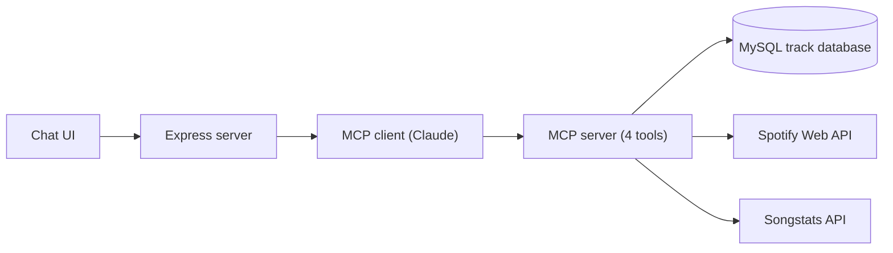

# DJ Assistant
**A conversation AI assistant that helps drum and bass DJs discover tracks and build setlists using natural language.**

Ask for "A 10-track setlist starting with Trouble Maker by DJ Hazard". Claude picks the right tool, queries a track database and returns a harmonically compatible setlist that you can export straight to Spotify.

Final-year dissertation project, BSc (Hons) Software Engineering. 

**SUS usability score:** 86.25 across six DJs

**Final Grade:** 71%

## Demo video
https://github.com/user-attachments/assets/7ce1fbec-d479-4b5d-9d16-688268bf650a

## Stack
- **Language:** TypeScript (Node.js, ES modules)
- **AI:** Anthropic Claude via @anthropic-ai/sdk
- **Protocol:** @modelcontextprotocol/sdk (stdio transport)
- **Server:** Express
- **Database:** MySQL (mysql2)
- **External APIs:** Spotify Web API (search, OAuth, playlists), Songstats API (audio analysis)
- **Validation:** Zod
- **Front end:** Plain HTML, CSS and JavaScript

## What it does
- **Search with plain English:** "energetic tracks, 172–176 BPM, F minor, before 2015" becomes a parameterised SQL query.
- **Recommend what to mix next:** give it a track and get back tracks that would mix well with it.
- **Generate setlists** of tracks from a single seed track.
- **Export to Spotify** as a private playlist.

## How it works


Claude decides which of four MCP tools to call (search_tracks, recommend_from_track, generate_setlist, export_setlist_to_spotify). Tracks come from real data rather than the model's memory, which cuts down on hallucinated suggestions.

**The track database.** I pre populated the MySQL database myself with around 500 drum and bass tracks, using a separate import script. The script took tracks from a selection of my own Spotify playlists, then got each track's metadata (key, BPM, energy, danceability, release date) from the Songstats API. All searches, recommendations and setlists are drawn from it. If you ask for recommendations based on a track that isn't in the database, the app gets that track's data from Spotify and Songstats and uses it for that request only.

The app already has everything it needs to save those tracks, but because of time constraints, and because 500 tracks was plenty of test data during development, I didn't add that step.

**Compatibility scoring.** Keys are converted to Camelot notation, and each candidate is scored on:
| Harmonic match | Energy | Danceability | Tempo |
|:-:|:-:|:-:|:-:|
| 50% | 25% | 15% | 10% |

Candidates are limited to tracks released within ±4 years of the reference track. Setlists pick at random from the top 5 candidates, so the same seed doesn't always produce the same set.

## Limitations and future work
- **Subgenres:** the metadata APIs label most tracks just "Drum and Bass", so liquid and jump up tracks can end up mixed together. Future work: analyse audio directly and use a larger dataset.
- **Tool-call reliability:** Claude Haiku (chosen for cost) sometimes says it exported a playlist without actually calling the tool.
- **API:** Spotify removed its audio features endpoint and later its popularity endpoint during the project, which is why Songstats is used.
- **Front end:** the front end is deliberately plain HTML, CSS and JS, because the research question was whether an MCP server and an LLM are useful for DJs. If I came back to this, I'd rebuild it in React.
- **Growing the database:** save tracks fetched from Spotify and Songstats to the database, so it grows as the app is used and repeat API calls (and costs) go down.
- **Live use:** real-time recommendations during a live set, suggested in the paper as a next step.

## Running Locally
**Requirements:** Node.js 20+, MySQL, and keys for Anthropic, Spotify (developer app) and Songstats.
```
npm install
npm run build
npm run start:web   # http://localhost:3000
```
The web server starts the MCP server itself, so run the command from the project root.
Create a ```.env``` file in the root, and copy the ```.env.example```

The app expects a ```tracks``` table. The track data isn't included in this repo, so you'll need to fill the table with your own tracks:
```
CREATE TABLE tracks (
    spotifyID      VARCHAR(32)  PRIMARY KEY,
    track_name     VARCHAR(255) NOT NULL,
    track_artists  VARCHAR(255) NOT NULL,
    genres         VARCHAR(255),
    release_date   DATE,
    danceability   FLOAT,
    key_sig        VARCHAR(3),
    mode           TINYINT,     -- 0 = minor, 1 = major
    tempo          FLOAT,
    energy         FLOAT,
    spotify_URL    VARCHAR(255)
);
```

## Running on Claude Desktop
The tools live in a standalone MCP server, they aren't tied to my web app. The same server also runs inside **Claude Desktop**, which is how the early iterations were tested before the web front end existed.
**Using it in Claude Desktop (optional)**

After running `npm run build`, add this to your `claude_desktop_config.json`:

```
json
{
  "mcpServers": {
    "dj-assistant": {
      "command": "node",
      "args": ["/absolute/path/to/project/build/server.js"],
      "env": {
        "DB_HOST": "localhost",
        "DB_USER": "...",
        "DB_PASSWORD": "...",
        "DB_NAME": "...",
        "SPOTIFY_CLIENT_ID": "...",
        "SPOTIFY_CLIENT_SECRET": "...",
        "SONGSTATS_API_KEY": "..."
      }
    }
  }
}
```

Restart Claude Desktop and the four tools will be available in chat. Exporting to Spotify still needs a login through the web app first.
